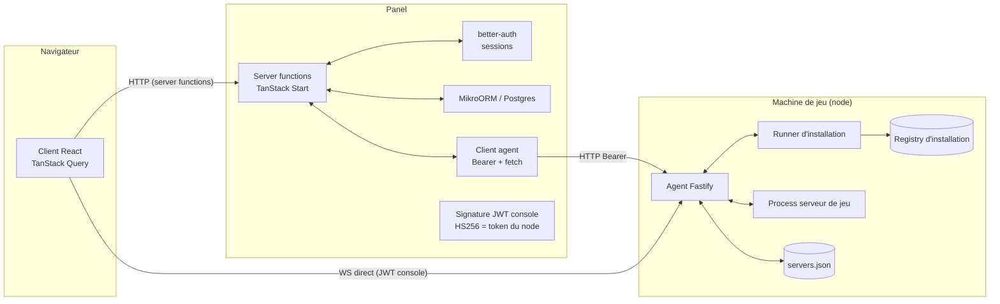
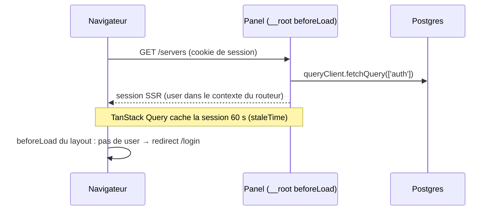
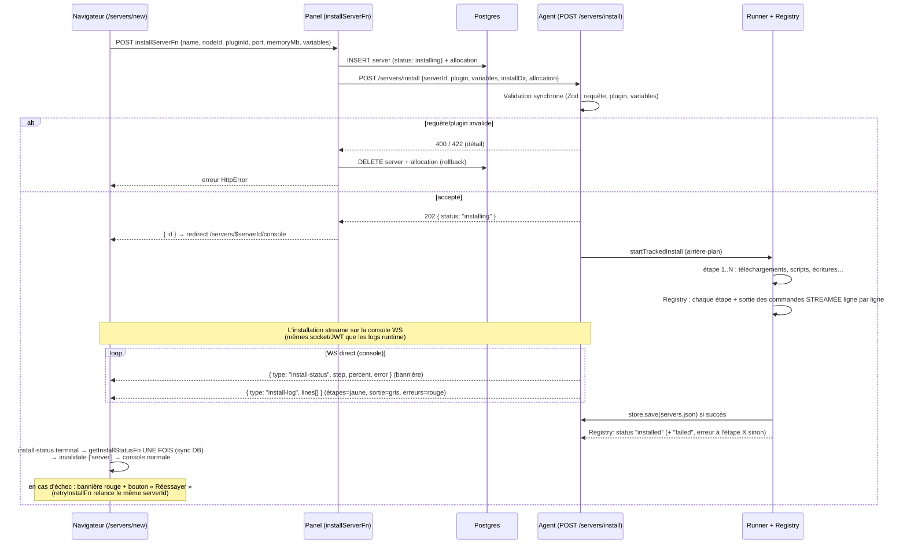
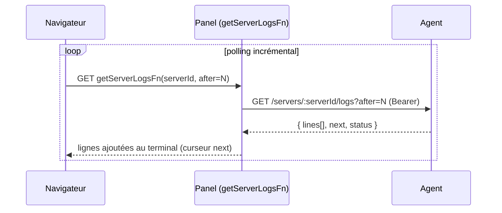
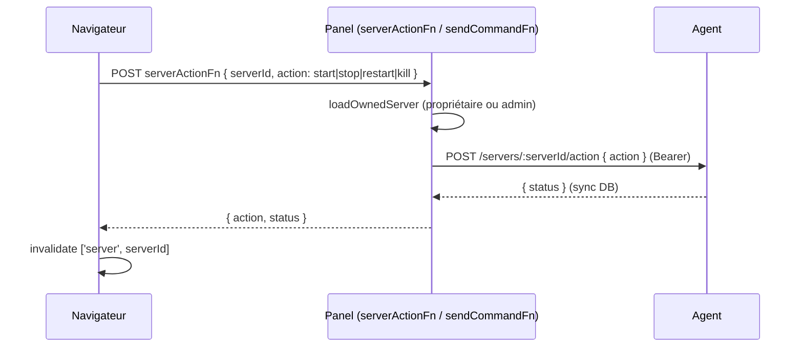
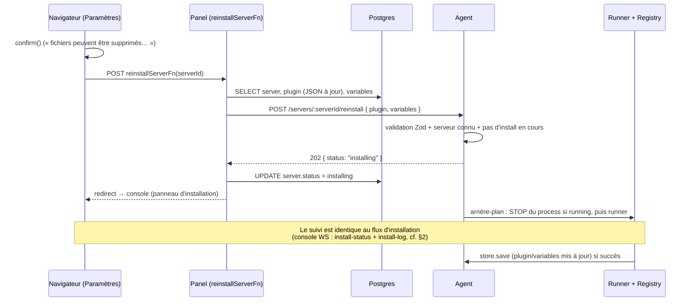
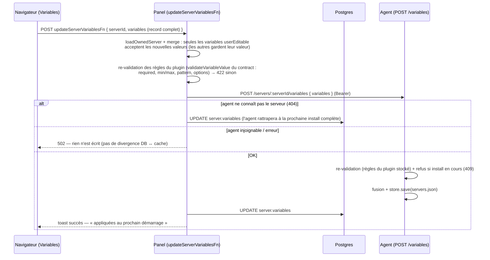
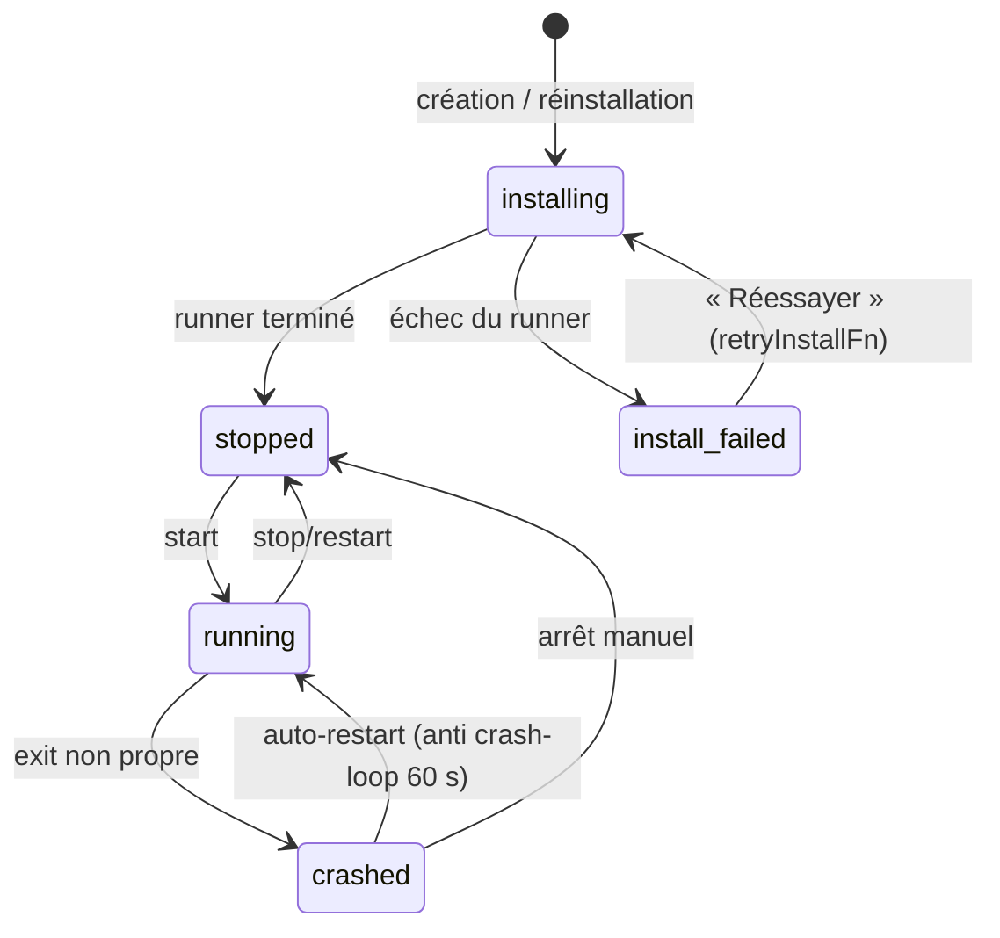

# Communications Panel ↔ Agent ↔ Client web

> Référence des flux de communication entre les trois acteurs du système.
> Les schémas Zod partagés (`@mojito/contract`) font foi : ce document décrit
> les *workflows*, pas les types exacts (voir `packages/contract/src/api.ts`).

## Acteurs

| Acteur | Rôle |
|---|---|
| **Client web** (navigateur) | React 19 + TanStack Router/Query. Ne parle JAMAIS directement au panel pour les actions serveur : il appelle des *server functions* TanStack Start (SSR-aware), ou l'agent en direct pour la console (JWT court). |
| **Panel** (`@mojito/panel`) | TanStack Start (SSR Node). Seul détenteur de la DB (Postgres/MikroORM) et des sessions (better-auth). Parle à l'agent en HTTP `Bearer <token du node>` (token chiffré AES-256-GCM au repos). |
| **Agent** (`@mojito/agent`) | Fastify, 1 par machine. Daemon générique : exécute le runner d'installation des plugins, gère les process de jeu, expose la console WS. Ne connaît ni les joueurs ni la DB. |

**Règles d'or**
- Le panel ne touche jamais aux serveurs de jeu : tout passe par l'agent.
- Le client ne parle à l'agent QUE via la console WS, avec un JWT court signé par le panel avec le token du node (secret partagé panel ↔ agent, 1 par node — style Pelican).
- Le token d'agent n'est jamais loggé, ni envoyé au navigateur.

---

## 1. Authentification (session SSR)

- Login/register/signOut → `queryClient.invalidateQueries({ queryKey: ['auth'] })`.
- Garde d'accès : `_app` (connecté), `admin/route.tsx` (rôle admin), `servers/$serverId/route.tsx` (connecté) — la propriété du serveur est vérifiée côté **server function** (`loadOwnedServer`), pas dans le routeur.

---

## 2. Création + installation d'un serveur (async, suivi en direct)

L'installation peut durer des minutes (JDK, JAR Mojang…). Elle démarre en **arrière-plan** côté agent, et le navigateur suit la progression étape par étape.

**Points clés**
- Le panel persiste **avant** d'appeler l'agent : l'utilisateur est redirigé immédiatement vers la console du serveur.
- La validation rapide (variables inconnues/invalides) est refusée **avant** le 202 → le formulaire affiche l'erreur et les lignes DB sont retirées.
- Un échec du runner (téléchargement 404, script en erreur…) n'est PAS une erreur HTTP : il apparaît dans le statut d'installation (`failed` + `error`), le store n'est pas modifié, la DB passe `install_failed`.
- **Pas de polling** en chemin nominal : les étapes et la sortie des commandes sont poussées par l'agent sur le socket console (`install-status` + `install-log`). `getInstallStatusFn` n'est appelé qu'**une fois** à la fin (statut terminal) pour synchroniser la DB (`installing → stopped / install_failed`).
- **Fallback** : si le WS n'est pas utilisable (proxy sans WS, origine refusée…), la page retombe sur le polling `GET /servers/:serverId/install` (panneau d'installation dédié).
- Logs d'installation (registry, en mémoire côté agent) : niveaux `step` (jaune), `info` (gris), `error` (rouge) ; la sortie des commandes est streamée **au fil de l'eau** — les réécritures `\r` (barres de progression type steamcmd) remplacent la ligne précédente au lieu de s'empiler, les lignes identiques consécutives sont fusionnées ; plafond 2000 lignes (dernières conservées).
- **Outils muets sur un pipe** : certains programmes console (steamcmd) n'impriment leur progression que sur un vrai terminal — sur un pipe ils restent silencieux. Une action `command` peut déclarer `tail` (`file` + `filter` regex + `intervalMs`) : l'agent tail le log écrit pendant l'exécution (ex : `logs/content_log.txt` de steamcmd) et streame les nouvelles lignes en direct.
- Une action `command` peut déclarer `successCodes` (codes de sortie traités comme succès) — steamcmd sort avec le code 7 après son auto-update (`Update complete, launching...`) alors que le job a réussi.
- Les logs d'installation vivent dans la mémoire de l'agent (registry) : perdus si l'agent redémarre, le statut DB reste `install_failed` avec bouton *Réessayer*. À la (re)connexion WS, une installation **en cours ou échouée** est rejouée (`install-log` + `reset`), une installation terminée ne l'est pas.

---

## 3. Console temps réel (navigateur ↔ agent en direct)

Deux modes : WS direct (chemin nominal) ou polling via le panel (fallback si WS impossible).

**Fallback polling** (WS indisponible : proxy sans WS, agent vieux, origine refusée — 3 tentatives max) :

En mode dégradé, une installation en cours bascule aussi sur le polling : le panneau d'installation dédié (`getInstallStatusFn` → `GET /servers/:serverId/install`) remplace la console.

**Sécurité console**
- JWT court (300 s), rafraîchi par re-`auth` — jamais de token dans l'URL/query string.
- `scope: websocket`, `serverId` verrouillé sur le paramètre de route WS.
- Chaque message est re-vérifié (permissions + expiration) ; l'agent peut rate-limiter (`error: rate-limited`).
- L'origine du navigateur est vérifiée par l'agent (`allowedOrigins`).

---

## 4. Actions power & commandes (chemin panel)

Quand le WS direct n'est pas actif, les actions passent par des server functions (même validation de propriétaire côté panel, même Bearer côté agent) :

`kill` force-passe le verrou du serveur (un process coincé reste tuable, comme wings). Les erreurs agent sont mappées : `not_found` → 404, conflit d'état → 409.

---

## 5. Réinstallation (Paramètres → console)

Même runner que l'installation, mais **en place** : arrêt du serveur, dossier et allocation conservés, plugin **à jour** envoyé par le panel.

**Serveur inconnu côté agent** — le store de l'agent (`servers.json`) n'est écrit qu'en cas de **succès** d'installation. Une installation échouée (ou un dataDir agent perdu) laisse donc la DB panel et le store agent désynchronisés, et `/reinstall` répond 404. Le panel gère ce cas : sur 404, `reinstallServerFn` retombe sur une **installation complète** (`POST /servers/install`) reconstruite depuis la DB (plugin courant, variables, allocation, `installDir` = `servers/<uuid>`).

---

## 6. Édition des variables (page Variables)

La page `/servers/$serverId/variables` (ex-« Démarrage ») édite les variables du plugin
après l'installation. La **DB panel est la source de vérité** (colonne `server.variables`) ;
l'agent ne garde qu'un **cache** (`servers.json`) utilisé au start. Comme wings tire sa
config du panel à chaque démarrage alors que l'agent mojito ne peut pas appeler le panel
(pas de credentials), c'est le panel qui **pousse** la sync au moment de la sauvegarde —
indispensable aussi parce qu'un start peut être déclenché directement par le navigateur
via le WS console, sans passer par le panel.

**Points clés**
- Validation en **trois couches** qui partagent la même fonction du contract :
  schéma de formulaire (TanStack Form, messages mappés par champ), server function (422),
  agent (422). Aucune divergence possible entre les règles.
- Les nouvelles valeurs s'appliquent au **prochain start** (résolution du templating,
  env au spawn, provisioning des outils `java`/`steamcmd`) — un process en cours garde
  son environnement d'origine.
- Les variables `userViewable && !userEditable` s'affichent en lecture seule ;
  les non-viewables restent dans le record mais ne sont pas éditables.
- La commande de démarrage résolue est affichée en lecture seule : les variables du
  plugin sont substituées en direct (valeur courante > default), les variables système
  (`{{SERVER_…}}`) restent littérales — seul l'agent peut les résoudre.

---

## 7. Cycle de vie d'un serveur (statuts)

- Le statut **DB** est synchronisé par les server functions (`getServerFn` interroge l'agent et corrige la DB ; `getInstallStatusFn` suit l'installation).
- L'agent connaît un état runtime plus fin (`offline/starting/running/stopping`) mappé vers les 5 statuts panel.

---

## 8. Référence des routes

### Panel ↔ Agent (Bearer token du node — `AGENT_ROUTES`)

| Route | Usage |
|---|---|
| `GET /health` | Public — healthcheck (version, uptime) |
| `POST /servers/install` | Démarre une installation (202) — validation sync 400/422 |
| `POST /servers/:serverId/reinstall` | Réinstalle en place (202, arrête le serveur d'abord) |
| `GET /servers/:serverId/install` | Statut d'installation + logs (sync fin d'install + fallback polling) |
| `POST /servers/:serverId/variables` | Sync du cache de variables (fusion + re-validation, refus si install en cours) — cf. §6 |
| `GET /servers` | Liste des serveurs de l'agent |
| `GET /servers/:serverId` | Info runtime (statut, logs récents) |
| `GET /servers/:serverId/logs?after=N` | Logs incrémentaux (fallback console) |
| `POST /servers/:serverId/action` | start / stop / restart / kill |
| `POST /servers/:serverId/command` | Commande stdin |
| `DELETE /servers/:serverId` | Suppression (refus si install ou process actif) |
| `GET /servers/:serverId/ws` | Console navigateur — JWT console (voir §3) |

### Navigateur ↔ Agent (WS console, JWT)

| Message (→ agent) | Message (← agent) |
|---|---|
| `{ type: "auth", token }` | `{ type: "auth-ok" }` |
| `{ type: "command", command }` | `{ type: "log", lines[] }` (runtime) |
| `{ type: "power", action }` | `{ type: "status", status }` |
| | `{ type: "install-status", status, step, totalSteps, percent, message, error }` |
| | `{ type: "install-log", lines[], reset, replace }` — `reset` = rejeu complet (effacer la console), `replace` = réécriture `\r` (progress), niveaux `step`/`info`/`error` |
| | `{ type: "error", code }` |

### Server functions exposées au navigateur (`packages/panel/src/server/functions/`)

| Fonction | Méthode | Rôle |
|---|---|---|
| `installServerFn` | POST | Créer + démarrer l'installation |
| `getInstallStatusFn` | GET | Statut/logs d'installation (sync fin d'install + fallback polling) |
| `retryInstallFn` | POST | Relancer une installation échouée |
| `listServersFn` | GET | Liste (admin : tout, sinon les siens) |
| `getServerFn` | GET | Détail + sync runtime + logs |
| `getServerLogsFn` | GET | Logs incrémentaux (fallback console) |
| `createConsoleTokenFn` | POST | JWT console + wsUrl |
| `serverActionFn` | POST | start/stop/restart/kill |
| `sendCommandFn` | POST | Commande stdin via panel |
| `reinstallServerFn` | POST | Réinstallation en place |
| `updateServerVariablesFn` | POST | Édition des variables (merge userEditable + sync agent) — cf. §6 |
| `deleteServerFn` | POST | Suppression (agent + DB) |
