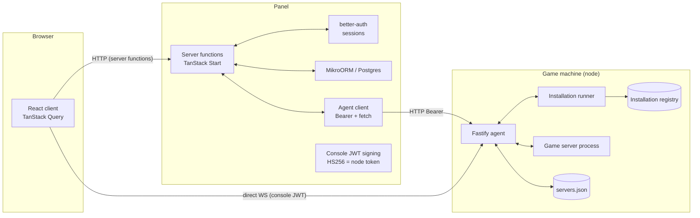
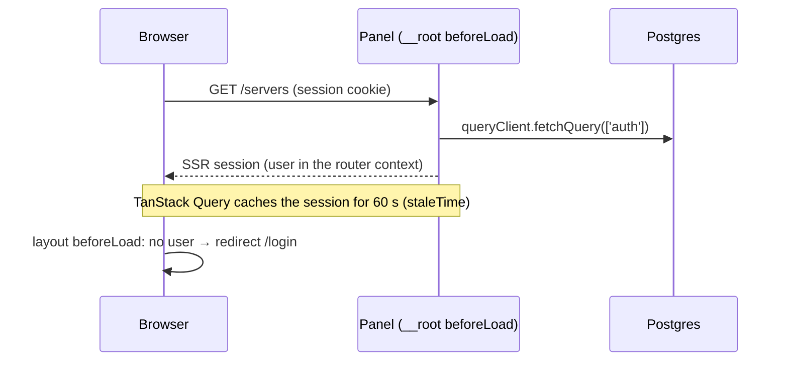
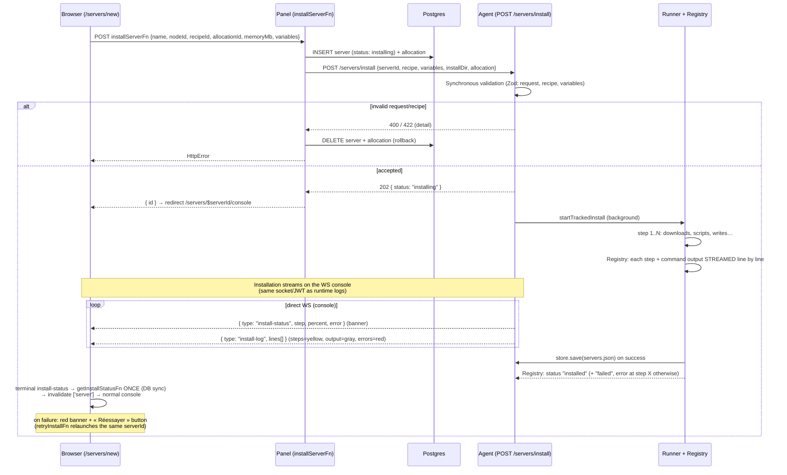
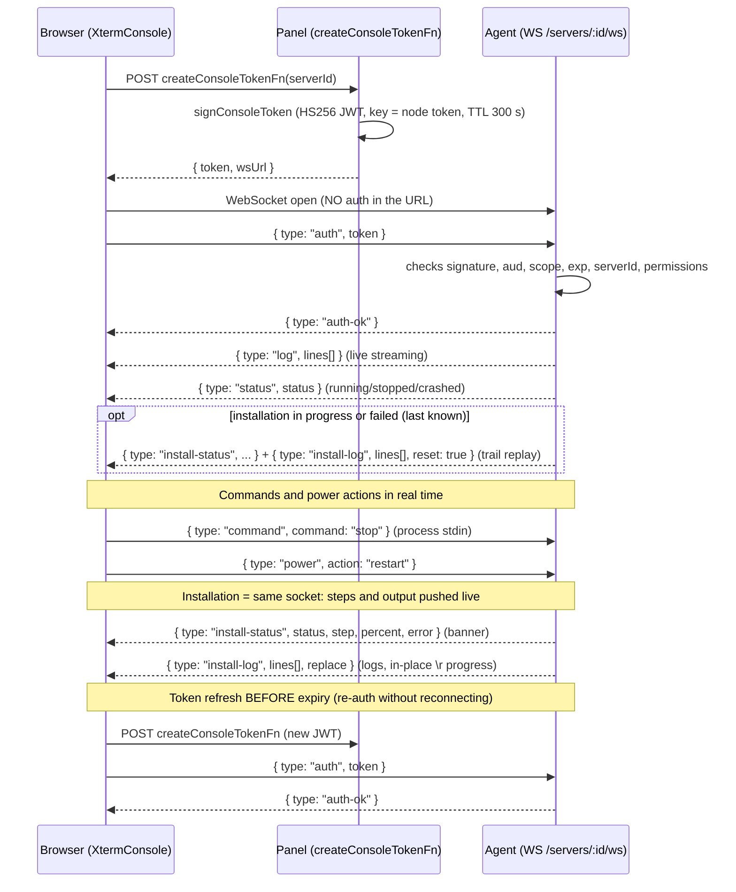
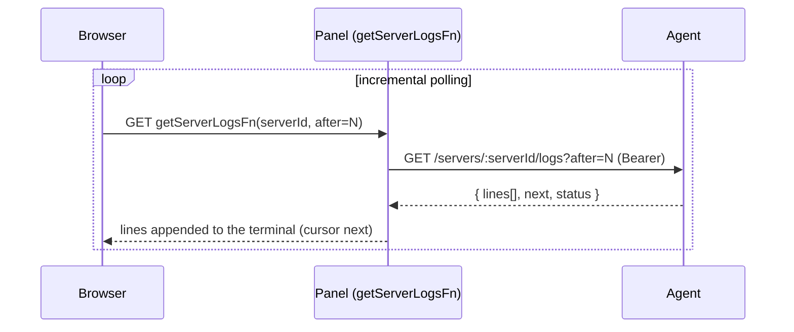
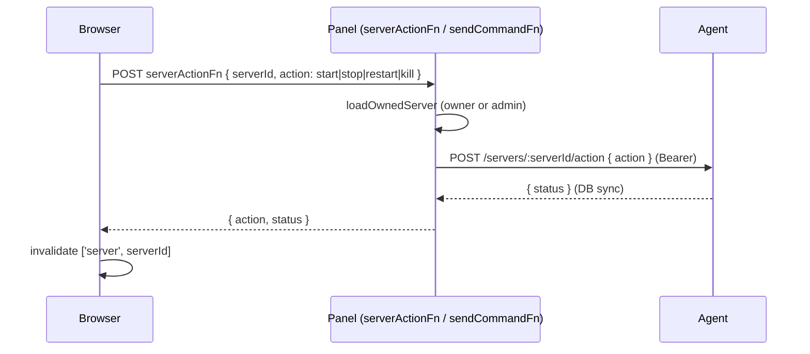
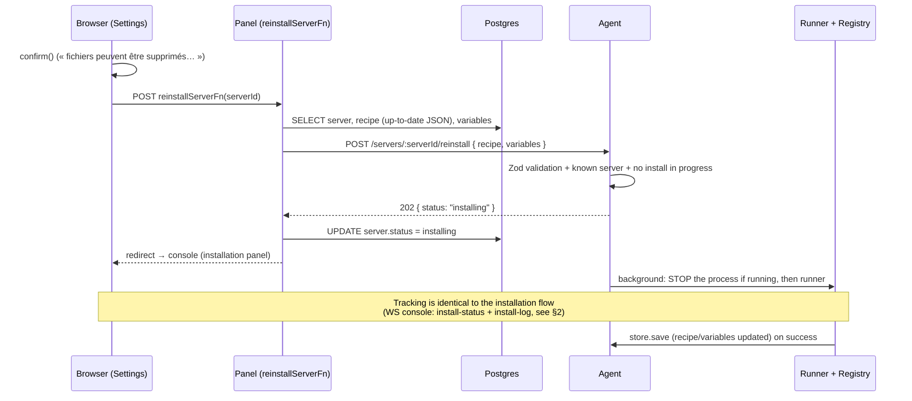
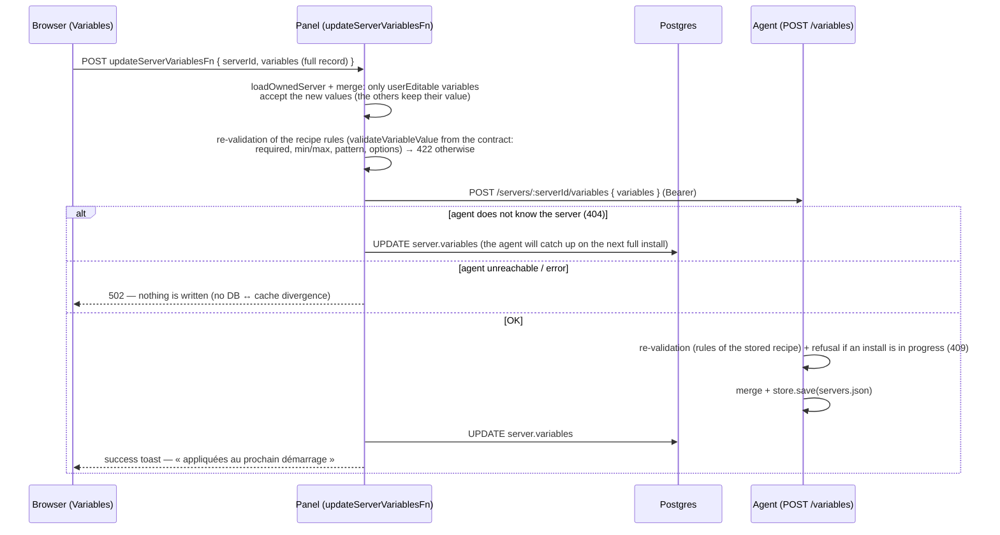
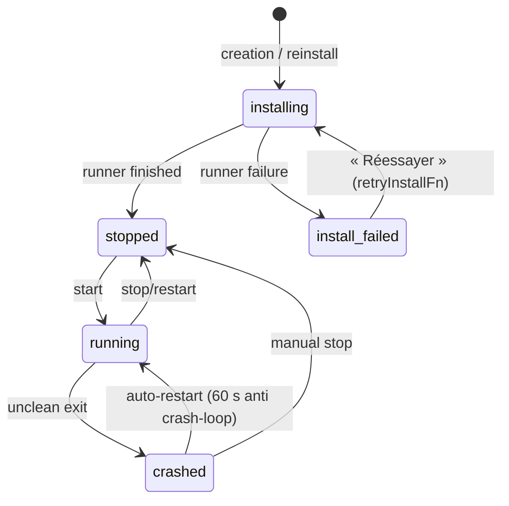
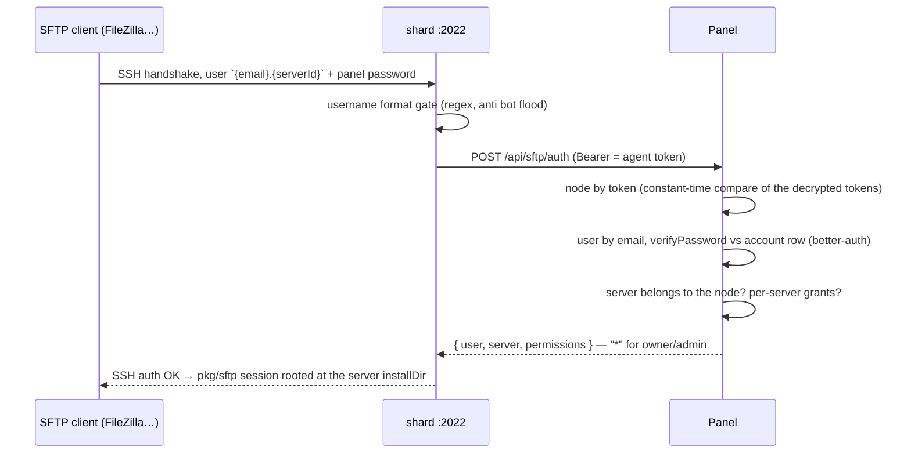

# Panel ↔ Agent ↔ Web client communications

> Reference for the communication flows between the three actors of the system.
> The shared Zod schemas (`src/contract`) are authoritative: this document describes
> the *workflows*, not the exact types (see `src/contract/api.ts`).

## Actors

| Actor | Role |
|---|---|
| **Web client** (browser) | React 19 + TanStack Router/Query. NEVER talks to game servers directly: it calls TanStack Start *server functions* (SSR-aware), or the agent directly for the console (short-lived JWT). |
| **Panel** (this repo) | TanStack Start (Node SSR). Sole owner of the DB (Postgres/MikroORM) and of sessions (better-auth). Talks to the agent over HTTP `Bearer <node token>` (token encrypted AES-256-GCM at rest). |
| **Agent** (external, one per machine) | Fastify, 1 per machine. Generic daemon: runs the recipe installation runner, manages game processes, exposes the WS console. Knows nothing about players or the DB. |

**Golden rules**
- The panel never touches game servers: everything goes through the agent.
- The client talks to the agent ONLY via the WS console, with a short-lived JWT signed by the panel using the node token (panel ↔ agent shared secret, 1 per node — Pelican style).
- The agent token is never logged, nor sent to the browser.

---

## 1. Authentication (SSR session)

- Login/register/signOut → `queryClient.invalidateQueries({ queryKey: ['auth'] })`.
- Access guards: `_app` (logged in), `admin/route.tsx` (admin role), `servers/$serverId/route.tsx` (logged in) — server ownership is verified on the **server function** side (`loadOwnedServer`), not in the router.

---

## 2. Server creation + installation (async, live tracking)

Installation can take minutes (JDK, Mojang JAR…). It starts in the **background** on the agent side, and the browser tracks progress step by step.

**Key points**
- The panel persists **before** calling the agent: the user is immediately redirected to the server console.
- Fast validation (unknown/invalid variables) is rejected **before** the 202 → the form displays the error and the DB rows are removed.
- A runner failure (404 download, failing script…) is NOT an HTTP error: it shows up in the installation status (`failed` + `error`), the store is not modified, the DB switches to `install_failed`.
- **No polling** on the happy path: steps and command output are pushed by the agent on the console socket (`install-status` + `install-log`). `getInstallStatusFn` is called only **once** at the end (terminal status) to synchronize the DB (`installing → stopped / install_failed`).
- **Fallback**: if WS is not usable (proxy without WS, refused origin…), the page falls back to polling `GET /servers/:serverId/install` (dedicated installation panel).
- Installation logs (registry, in memory on the agent side): levels `step` (yellow), `info` (gray), `error` (red); command output is streamed **as it comes** — `\r` rewrites (progress bars like steamcmd's) replace the previous line instead of stacking up, consecutive identical lines are merged; 2000-line cap (latest kept).
- **Tools silent on a pipe**: some console programs (steamcmd) print their progress only on a real terminal — on a pipe they stay silent. A `command` action can declare `tail` (`file` + regex `filter` + `intervalMs`): the agent tails the log file written during execution (e.g. steamcmd's `logs/content_log.txt`) and streams the new lines live.
- A `command` action can declare `successCodes` (exit codes treated as success) — steamcmd exits with code 7 after its self-update (`Update complete, launching...`) even though the job succeeded.
- Installation logs live in the agent's memory (registry): lost if the agent restarts, the DB status stays `install_failed` with the *Réessayer* button. On WS (re)connection, an **in-progress or failed** installation is replayed (`install-log` + `reset`), a finished installation is not.

---

## 3. Real-time console (browser ↔ agent direct)

Two modes: direct WS (happy path) or polling via the panel (fallback if WS impossible).

**Polling fallback** (WS unavailable: proxy without WS, old agent, refused origin — 3 attempts max):

In degraded mode, an in-progress installation also switches to polling: the dedicated installation panel (`getInstallStatusFn` → `GET /servers/:serverId/install`) replaces the console.

**Console security**
- Short-lived JWT (300 s), refreshed via re-`auth` — never a token in the URL/query string.
- `scope: websocket`, `serverId` locked to the WS route parameter.
- Every message is re-checked (permissions + expiry); the agent can rate-limit (`error: rate-limited`).
- The browser origin is checked by the agent (`allowedOrigins`).

---

## 4. Power actions & commands (panel path)

When direct WS is not active, actions go through server functions (same owner validation on the panel side, same Bearer on the agent side):

`kill` force-bypasses the server lock (a stuck process stays killable, like wings). Agent errors are mapped: `not_found` → 404, state conflict → 409.

---

## 5. Reinstallation (Settings → console)

Same runner as installation, but **in place**: server stopped, directory and allocation kept, **up-to-date** recipe sent by the panel.

**Unknown server on the agent side** — the agent's store (`servers.json`) is written only on installation **success**. A failed installation (or a lost agent dataDir) therefore leaves the panel DB and the agent store out of sync, and `/reinstall` answers 404. The panel handles this case: on 404, `reinstallServerFn` falls back to a **full installation** (`POST /servers/install`) rebuilt from the DB (current recipe, variables, allocation, `installDir` = `servers/<uuid>`).

---

## 6. Variable editing (Variables page)

The `/servers/$serverId/variables` page (formerly "Startup") edits the recipe variables
after installation. The **panel DB is the source of truth** (`server.variables` column);
the agent only keeps a **cache** (`servers.json`) used at start. While wings pulls its
config from the panel on every boot, the mojito agent cannot call the panel
(no credentials), so the panel **pushes** the sync at save time — this is also
essential because a start can be triggered directly by the browser
via the WS console, without going through the panel.

**Key points**
- Validation in **three layers** sharing the same contract function:
  form schema (TanStack Form, messages mapped per field), server function (422),
  agent (422). No divergence possible between the rules.
- New values apply on the **next start** (templating resolution,
  env at spawn, `java`/`steamcmd` tool provisioning) — a running process keeps
  its original environment.
- `userViewable && !userEditable` variables display as read-only;
  non-viewable ones stay in the record but are not editable.
- The resolved startup command is displayed read-only: recipe variables are
  substituted live (current value > default), system variables
  (`{{SERVER_…}}`) stay literal — only the agent can resolve them.

---

## 7. Server lifecycle (statuses)

- The **DB** status is synchronized by server functions (`getServerFn` queries the agent and corrects the DB; `getInstallStatusFn` tracks the installation).
- The agent knows a finer runtime state (`offline/starting/running/stopping`) mapped to the 5 panel statuses.

---

## 8. SFTP (agent hosts the server, panel validates the credentials)

The SFTP subsystem is the ONE flow where the agent calls the panel (wings
model): shard hosts the SFTP server (`crypto/ssh` + `pkg/sftp`, default
port 2022, opt-in via `sftp.enabled` in shard.yml — the panel generates the
section), but never stores a credential itself. The SFTP username is
`{email}.{serverId}` and the password is the user's PANEL account password
(Pelican reuses the account password the same way).

- Permissions: the panel maps `server.files.*` grants onto the agent's
  closed list (`file.read`, `file.read-content`, `file.create`,
  `file.update`, `file.delete`); owners/admins get `*`. The agent gates
  EVERY operation on them (`internal/sftp/handler.go`).
- All failures answer the same 403 — the panel never distinguishes
  unknown node/user, bad password or missing grant (no user enumeration).
- Filesystem sandboxing is the SAME gate as the file API
  (`files.ResolveServerPath`): traversal, drive letters and
  Windows-forbidden characters are refused.
- The Files page shows the connection details (host `fqdn:sftpPort`,
  username, "password = panel password") to users holding any
  `server.files.*` grant.

---

## 9. Route reference

### Panel ↔ Agent (node Bearer token — `AGENT_ROUTES`)

| Route | Usage |
|---|---|
| `GET /health` | Public — healthcheck (version, uptime) || `POST /servers/install` | Start an installation (202) — sync validation 400/422 |
| `POST /servers/:serverId/reinstall` | Reinstall in place (202, stops the server first) |
| `GET /servers/:serverId/install` | Installation status + logs (end-of-install sync + polling fallback) |
| `POST /servers/:serverId/variables` | Variable cache sync (merge + re-validation, refused if an install is in progress) — see §6 |
| `POST /servers/:serverId/allocation` | Primary allocation sync (port/ip of the next start, refused if an install is in progress) — see §6 |
| `GET /servers` | List of the agent's servers |
| `GET /servers/:serverId` | Runtime info (status, recent logs) |
| `GET /servers/:serverId/logs?after=N` | Incremental logs (console fallback) |
| `POST /servers/:serverId/action` | start / stop / restart / kill |
| `POST /servers/:serverId/command` | stdin command |
| `DELETE /servers/:serverId` | Deletion (refused if an install or a process is active) |
| `GET /servers/:serverId/ws` | Browser console — console JWT (see §3) |

### Agent → Panel (node Bearer token — `PANEL_ROUTES`)

| Route | Usage |
|---|---|
| `POST /api/sftp/auth` | SFTP credential validation (see §8) — the only agent → panel call |

### Browser ↔ Agent (WS console, JWT)

| Message (→ agent) | Message (← agent) |
|---|---|
| `{ type: "auth", token }` | `{ type: "auth-ok" }` |
| `{ type: "command", command }` | `{ type: "log", lines[] }` (runtime) |
| `{ type: "power", action }` | `{ type: "status", status }` |
| | `{ type: "install-status", status, step, totalSteps, percent, message, error }` |
| | `{ type: "install-log", lines[], reset, replace }` — `reset` = full replay (clear the console), `replace` = `\r` rewrite (progress), levels `step`/`info`/`error` |
| | `{ type: "error", code }` |

### Server functions exposed to the browser (`src/server/functions/`)

| Function | Method | Role |
|---|---|---|
| `installServerFn` | POST | Create + start the installation |
| `getInstallStatusFn` | GET | Installation status/logs (end-of-install sync + polling fallback) |
| `retryInstallFn` | POST | Relaunch a failed installation |
| `listServersFn` | GET | List (admin: everything, otherwise own servers) |
| `getServerFn` | GET | Detail + runtime sync + logs |
| `getServerLogsFn` | GET | Incremental logs (console fallback) |
| `createConsoleTokenFn` | POST | Console JWT + wsUrl |
| `serverActionFn` | POST | start/stop/restart/kill |
| `sendCommandFn` | POST | stdin command via panel |
| `reinstallServerFn` | POST | In-place reinstallation |
| `updateServerVariablesFn` | POST | Variable editing (userEditable merge + agent sync) — see §6 |
| `getServerNetworkFn` | GET | Server allocations + free ones on the node (Network page) |
| `addServerAllocationFn` | POST | Claim a free allocation on the node |
| `removeServerAllocationFn` | POST | Release a non-primary allocation |
| `setPrimaryServerAllocationFn` | POST | Set the primary allocation + agent sync (next start) |
| `deleteServerFn` | POST | Deletion (agent + DB, allocations returned to the node pool) |
